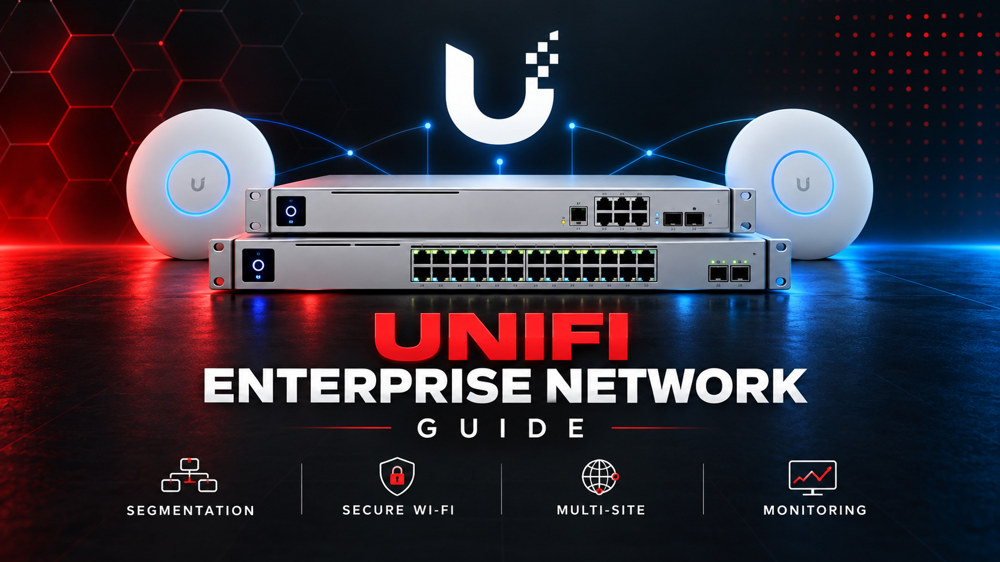

# UniFi Enterprise Network Guide

<p align="center">
  
</p>


[](https://github.com/sarabelinformatika/unifi-enterprise-network-guide/releases/tag/v1.0.0)
[](LICENSE)

A production-oriented architecture, security, deployment, and operations guide for enterprise UniFi networks. It covers Cloud Gateways and self-hosted Network Servers, switching, PoE, AP and RF design, VLANs, firewall zones, guest/IoT isolation, WPA2/WPA3-Enterprise, RADIUS, roaming, WAN resilience, VPN, backup, monitoring, automation, acceptance, and incident response.

This independent guide is published by [SARABEL Informatika Kft.](https://sarabelinformatika.hu) as part of its practical infrastructure series. For professional network design, deployment, Wi-Fi assessment, segmentation, monitoring, and support, visit [SARABEL Informatika](https://sarabelinformatika.hu).

> A green controller dashboard is not acceptance evidence. A production network must be measured, segmented, recoverable, monitored, documented, and tested under failure.

## Reference architecture

| Layer | Typical components | Primary objective |
|---|---|---|
| Edge | UniFi Cloud Gateway, dual WAN, VPN | Controlled and resilient site connectivity |
| Core/distribution | Aggregation and L3-capable switching | Predictable routing and failure domains |
| Access | PoE switches, port profiles, edge protection | Secure endpoint and AP attachment |
| Wireless | Wi-Fi 6/6E/7 APs, surveyed RF plan | Coverage, capacity, roaming, and security |
| Services | DNS, DHCP, NTP, RADIUS, PKI | Reliable identity and network dependencies |
| Management | UniFi Network, MFA, backup, monitoring | Least privilege, visibility, and recovery |

## Guide map

1. [Scope, requirements, and threat model](docs/01-scope-requirements-and-threat-model.md)
2. [Discovery, site survey, and sizing](docs/02-discovery-site-survey-and-sizing.md)
3. [Platform, controller, and management architecture](docs/03-platform-controller-and-management-architecture.md)
4. [Reference topology, IP plan, and naming](docs/04-reference-topology-ip-plan-and-naming.md)
5. [Switching, VLANs, trunks, STP, and PoE](docs/05-switching-vlans-trunks-stp-and-poe.md)
6. [Wi-Fi RF design, capacity, and roaming](docs/06-wifi-rf-design-capacity-and-roaming.md)
7. [SSID security, WPA-Enterprise, and RADIUS](docs/07-ssid-security-wpa-enterprise-and-radius.md)
8. [Firewall zones, segmentation, and egress control](docs/08-firewall-zones-segmentation-and-egress.md)
9. [Guest, IoT, voice, cameras, and multicast](docs/09-guest-iot-voice-cameras-and-multicast.md)
10. [WAN redundancy, routing, DNS, DHCP, and IPv6](docs/10-wan-redundancy-routing-dns-dhcp-and-ipv6.md)
11. [Remote access, site-to-site VPN, and SD-WAN](docs/11-remote-access-site-to-site-vpn-and-sdwan.md)
12. [Monitoring, logging, alerting, and capacity](docs/12-monitoring-logging-alerting-and-capacity.md)
13. [Backup, restore, migration, and disaster recovery](docs/13-backup-restore-migration-and-disaster-recovery.md)
14. [Hardening, identity, updates, and supply chain](docs/14-hardening-identity-updates-and-supply-chain.md)
15. [Automation, API, change control, and testing](docs/15-automation-api-change-control-and-testing.md)
16. [Deployment, acceptance, operations, and incident response](docs/16-deployment-acceptance-operations-and-incident-response.md)

## Included operational material

- Four read-only assessment scripts
- Example site, VLAN, WLAN, and monitoring YAML files
- Ports, security controls, command catalogue, limitations, and primary sources
- Deployment, access, firewall, change, recovery, incident, and acceptance templates
- GitHub Actions checks for shell, YAML, Markdown links, and common secret patterns

## Quick start

```bash
git clone https://github.com/sarabelinformatika/unifi-enterprise-network-guide.git
cd unifi-enterprise-network-guide
chmod +x scripts/*.sh
./scripts/unifi-endpoint-preflight.sh https://unifi.example.invalid
./scripts/unifi-network-path-check.sh unifi.example.invalid
```

Review [SECURITY.md](SECURITY.md), [DISCLAIMER.md](DISCLAIMER.md), and [reference/limitations.md](reference/limitations.md) before production changes.

## Trademark notice

UniFi and Ubiquiti are trademarks of Ubiquiti Inc. This independent project is not an official Ubiquiti publication and is not endorsed by Ubiquiti Inc.

## License

Released under the [MIT License](LICENSE).
